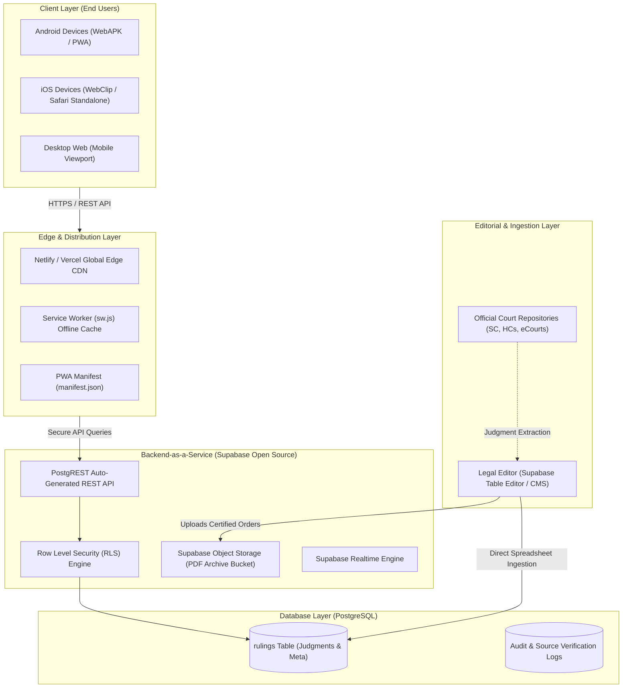
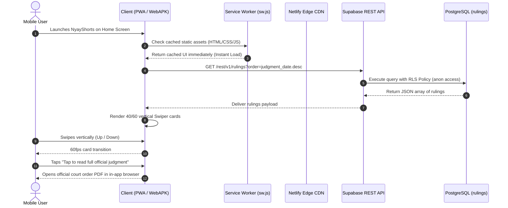

# High-Level Design (HLD) Document
## Project: NyayShorts — 100-Word Legal Rulings Platform

---

### 1. Executive Summary & Objective

**NyayShorts** is a mobile-first, bite-sized legal intelligence platform inspired by Inshorts. It delivers Supreme Court, High Court, and District Court judgments summarized strictly in **100 words** in plain English. The platform serves advocates, law students, judicial aspirants, and non-legal citizens who need to stay updated with judicial precedents without reading voluminous 50-page orders.

#### Core Product Tenets:
- **Zero-Friction Access:** No mandatory login wall or subscription paywall to read rulings.
- **100-Word Ratio Decidendi:** Rigorous editorial constraint ensuring only core legal holding, facts, and directions are presented.
- **Story-Specific Visual Context:** A 40% top media card that contextualizes the dispute rather than showing generic legal symbols.
- **Permanent Evidentiary Audit Trail:** Every case links to official signed court orders with archived cloud backup.
- **$0 Open-Source Tech Stack:** Engineered to run permanently on free, authentic, enterprise-grade cloud tiers with zero capital expenditure.

---

### 2. High-Level System Architecture

---

### 3. Key Architectural Decisions & Trade-Offs

| Decision | Alternative Considered | Rationale & Trade-Off |
| :--- | :--- | :--- |
| **Progressive Web App (PWA) + WebAPK** | Native App (Swift / Kotlin / Flutter) | **Rationale:** Zero store submission fees (\$0 vs \$99 Apple / \$25 Google), instant updates without store review delays, and bypasses Google's 14-day 20-tester policy. **Trade-off:** No access to native hardware sensors (not needed for reading text). |
| **Supabase (PostgreSQL)** | Firebase Firestore / MongoDB | **Rationale:** 100% open-source, relational integrity for court citations, built-in visual spreadsheet editor for non-technical legal editors, and generous permanent free tier (500MB DB, 1GB storage). |
| **Swiper.js Engine** | Custom Touch Gesture CSS | **Rationale:** Industry-standard 60fps vertical touch physics, haptic bounce resistance, hardware acceleration, and cross-browser gesture consistency. |
| **Static Edge Hosting (Netlify)** | Dedicated Node.js/Python Server | **Rationale:** Zero server maintenance, instant global CDN deployment, zero idle cost, and automatic HTTPS security. |

---

### 4. System Components & Flow

#### 4.1 Ingestion & Editorial Flow (Publishing a Ruling)
1. **Source Discovery:** The legal editor accesses verified court registries (*Supreme Court Registry, High Court Portals, eCourts*).
2. **100-Word Synthesis:** The case is summarized into exactly 95–100 words (Title, Coram/Bench, Ratio Decidendi, Facts).
3. **Database Entry:** The editor enters the ruling into the Supabase visual table editor.
4. **Permanent Archival:** The official PDF is uploaded to Supabase Storage, generating an unalterable link.
5. **Instant Live Propagation:** All mobile users instantly receive the latest ruling on their feed upon next refresh without client-side app updates.

#### 4.2 Client Consumption Flow (Reading a Ruling)

---

### 5. Non-Functional Requirements (NFRs)

- **Performance & Latency:**
  - First Contentful Paint (FCP): `< 1.2s` on 4G networks.
  - Swipe Transition: `60 fps` hardware-accelerated transforms.
  - API Payload: Compressed JSON `< 15 KB` for initial 25 rulings.
- **Availability & Offline Resilience:**
  - 99.9% uptime backed by Netlify Edge and Supabase Cloud.
  - Offline mode: Users can read previously fetched rulings and saved bookmarks without active internet.
- **Security & Authorization:**
  - Row Level Security (RLS) restricts public client keys (`anon`) to `SELECT` (read-only) queries.
  - Zero PII (Personally Identifiable Information) collection; bookmarks are saved on-device via `localStorage`.
- **Legal Compliance:**
  - Clear informational disclaimer stating summaries are educational and do not constitute formal legal counsel under the Advocates Act.

---

### 6. Disaster Recovery & Source Provenance

- **Unbroken Chain of Custody:** To safeguard against broken court hyperlinks, each ruling record stores both `original_source_url` and an immutable `archived_pdf_url` hosted in Supabase Storage.
- **Database Backups:** Daily automated backups enabled via Supabase PostgreSQL WAL (Write-Ahead Logging).
