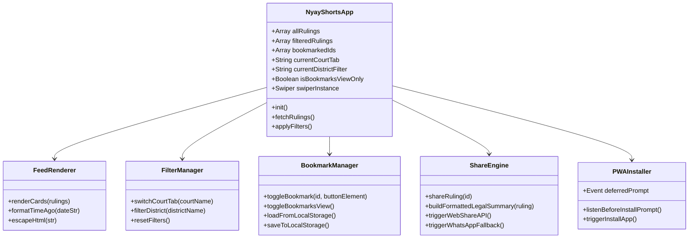

# Low-Level Design (LLD) Document
## Project: NyayShorts — 100-Word Legal Rulings Platform

---

### 1. Database Schema & Data Dictionary

The persistence layer is implemented in **PostgreSQL 15+** managed via Supabase.

#### 1.1 Table Specification: `public.rulings`

| Column Name | Data Type | Nullable | Default | Description |
| :--- | :--- | :--- | :--- | :--- |
| `id` | `bigint` | `NOT NULL` | `identity primary key` | Unique autoincrementing identifier for each case. |
| `created_at` | `timestamptz` | `NOT NULL` | `now()` | System insertion timestamp. |
| `title` | `text` | `NOT NULL` | - | Plain English case headline (max 15 words). |
| `court_level` | `text` | `NOT NULL` | - | Enumeration: `'Supreme Court'`, `'High Court'`, `'District Court'`. |
| `specific_court` | `text` | `NOT NULL` | - | Specific forum: e.g. `'Supreme Court of India'`, `'Delhi High Court'`, `'Rouse Avenue District Court'`. |
| `category` | `text` | `NOT NULL` | - | Legal practice area: e.g. `'Criminal Law'`, `'Constitutional Law'`, `'Commercial Law'`. |
| `bench` | `text` | `NOT NULL` | - | **Full names of all judges** who delivered the ruling (e.g. `Justice B.R. Gavai & Justice K.V. Viswanathan`). |
| `citation` | `text` | `NULL` | - | Official legal citation (e.g. `2024 INSC 615`, `2024 DHC 3412`). |
| `judgment_date` | `date` | `NOT NULL` | `current_date` | Date on which the judgment was pronounced. |
| `summary` | `text` | `NOT NULL` | - | **Strictly 95–100 words** containing ratio decidendi, relevant facts, and court directions. |
| `image_url` | `text` | `NULL` | - | Direct URL to a story-specific contextual photograph. |
| `pdf_url` | `text` | `NULL` | - | Hyperlink to official certified court order. |
| `source_name` | `text` | `NULL` | - | Editorial source: e.g. `'Supreme Court Registry'`, `'eCourts'`. |
| `original_source_url`| `text` | `NULL` | - | Original webpage link from where the order was retrieved. |
| `archived_pdf_url` | `text` | `NULL` | - | Permanent backup URL stored in Supabase Storage bucket. |
| `diary_number` | `text` | `NULL` | - | Official court registry filing number (e.g. `Diary No. 14210/2024`). |
| `verified_by` | `text` | `NULL` | `'Advocate / Legal Editor'` | Name or credential of the legal reviewer. |

#### 1.2 Database Indexes & Constraints
```sql
-- Indexes for low-latency filtering
create index if not exists idx_rulings_court_level on public.rulings(court_level);
create index if not exists idx_rulings_judgment_date on public.rulings(judgment_date desc);
create index if not exists idx_rulings_category on public.rulings(category);

-- Full-Text Search index for case titles and summaries
create index if not exists idx_rulings_fts on public.rulings 
using gin(to_tsvector('english', title || ' ' || summary));
```

#### 1.3 Row Level Security (RLS) Policies
```sql
-- Enable RLS
alter table public.rulings enable row level security;

-- Public Anonymous Read Policy (Mobile App Read-Only Access)
create policy "Allow public read access"
  on public.rulings
  for select
  to anon
  using (true);

-- Authenticated Admin Ingestion Policy (Only Logged-in Editors Can Write)
create policy "Allow authenticated admin insert/update"
  on public.rulings
  for all
  to authenticated
  using (true)
  with check (true);
```

---

### 2. API Contract & Integration Specifications

The mobile client communicates directly with Supabase via standard **PostgREST HTTP REST endpoints**.

#### 2.1 Fetch Latest Rulings
- **Method:** `GET`
- **Endpoint:** `https://<project-ref>.supabase.co/rest/v1/rulings`
- **Headers:**
  ```http
  apikey: <SUPABASE_PUBLISHABLE_KEY>
  Authorization: Bearer <SUPABASE_PUBLISHABLE_KEY>
  Accept: application/json
  ```
- **Query Parameters:**
  - `select=*`
  - `order=judgment_date.desc`
  - `limit=30`

#### 2.2 Sample JSON Response Payload
```json
[
  {
    "id": 1,
    "title": "Police and investigating agencies cannot conduct 'Digital Arrest' over video calls: Supreme Court",
    "court_level": "Supreme Court",
    "specific_court": "Supreme Court of India",
    "category": "Cyber Law & Criminal",
    "bench": "Chief Justice D.Y. Chandrachud, Justice J.B. Pardiwala & Justice Manoj Misra",
    "citation": "2024 INSC 780",
    "judgment_date": "2024-10-15",
    "summary": "Clarifying nationwide alarm regarding fraudulent cyber extortion schemes, the Supreme Court declared that Indian criminal jurisprudence does not recognize any concept called 'Digital Arrest'. The bench unequivocally held that no police officer, Central Bureau of Investigation, Enforcement Directorate, or customs official possesses any legal authority to confine citizens inside their homes, inspect premises, or demand money transfers through Skype, WhatsApp, or video calls. Directing state police chiefs and specialized cyber crime cells to conduct extensive public awareness campaigns, the apex court affirmed that citizens must immediately report such fraudulent calls without fear of arrest or harassment.",
    "image_url": "https://images.unsplash.com/photo-1563986768609-322da13575f3?auto=format&fit=crop&w=1000&q=80",
    "pdf_url": "https://main.sci.gov.in/"
  }
]
```

---

### 3. Client Component Architecture & State Machine



#### 3.1 State Transitions
1. **Initial Boot:**
   - App loads cached shell via `sw.js`.
   - `fetchRulings()` executes async HTTP fetch.
   - If network succeeds: `allRulings` populated ➔ `renderCards()` invoked.
   - If network fails: fallback cached dataset loaded.
2. **Tab Switch (`switchCourtTab`):**
   - Updates `currentCourtTab`.
   - Toggles District sub-filter row visibility if `District Courts` selected.
   - Re-filters `filteredRulings` in-memory.
   - Resets Swiper active index to `0` with smooth transition.
3. **Bookmark Toggle (`toggleBookmark`):**
   - Modifies `bookmarkedIds` array.
   - Serializes to `localStorage.setItem('nyay_bookmarks', JSON.stringify(...))`.
   - Updates bookmark icon SVG fill dynamically without re-rendering the whole slide.

---

### 4. UI Grid & Visual Styling Specifications

```
┌────────────────────────────────────────────────────────┐
│ <header> Top Bar (Height: 48px, Fixed, z-30)          │
│ [My Feed] [Supreme Court] [Delhi HC] [Bombay HC] ...   │
├────────────────────────────────────────────────────────┤
│ <main> Swiper Container (Height: 100vh - 48px - 64px)  │
│                                                        │
│  ┌──────────────────────────────────────────────────┐  │
│  │ Card: max-w-sm / max-w-md, rounded-3xl, mx-auto  │  │
│  │                                                  │  │
│  │  [ TOP 40% VIEWPORT HEIGHT ]                     │  │
│  │  - Contextual News Photo (object-cover)          │  │
│  │  - 3-Dots Menu Button (top-right)                │  │
│  │  - Carousel Indicator Dots (bottom-center)       │  │
│  │                                                  │  │
│  ├──────────────────────────────────────────────────┤  │
│  │  [ LOWER 60% VIEWPORT HEIGHT (White Card) ]      │  │
│  │  - Top Row: [🔖 Save] [🔗 Share] (Right-aligned) │  │
│  │  - Headline: 16-17px Bold SF Pro (Tight leading) │  │
│  │  - Body: 95-100 Words Ratio Decidendi (14px)     │  │
│  │  - Meta: Date • Bench: [Full Names of Judges]    │  │
│  │  - Apple Liquid Glass Frosted Button (PDF CTA)   │  │
│  └──────────────────────────────────────────────────┘  │
│                                                        │
├────────────────────────────────────────────────────────┤
│ <nav> Floating Apple Dock (Bottom: 12px, Fixed, z-40)  │
│      [ 🔍 Search ]   [ 🏠 Home ]   [ 🔖 Saved ]        │
└────────────────────────────────────────────────────────┘
```

#### 4.1 Apple Liquid Glass Specification
```css
.apple-liquid-glass {
  background: rgba(245, 247, 250, 0.78);
  backdrop-filter: blur(28px) saturate(190%);
  -webkit-backdrop-filter: blur(28px) saturate(190%);
  border: 1px solid rgba(255, 255, 255, 0.85);
  box-shadow: 0 8px 24px -4px rgba(0, 0, 0, 0.08), inset 0 1px 0 rgba(255, 255, 255, 0.95);
}
```

---

### 5. Service Worker Caching Strategy (`sw.js`)

- **Strategy: Cache-First for Shell, Network-Only for Database**
  - **Static Assets (Cached on Install):**
    - `index.html`
    - `manifest.json`
    - `icon-192.png`
    - `icon-512.png`
    - CDN bundles (Tailwind, Swiper.js, Supabase JS, Lucide icons)
  - **API Exemption Rule:**
    All requests containing `supabase.co` bypass the Service Worker cache completely. This guarantees that whenever an advocate opens the app, they receive live judicial rulings.

---

### 6. Editorial Guidelines & 100-Word Budgeting Rule

To maintain uniform card aesthetics without layout overflow, every entry must follow this exact editorial formula:

```
[Headline: 10 to 14 words]
[Facts & Trigger: 25 to 30 words]
[Held & Ratio Decidendi: 55 to 60 words]
-----------------------------------------
TOTAL WORD COUNT: Exactly 95 to 100 words.
```

- **Judges' Naming Standard:** Always write full formal titles (e.g. *Chief Justice D.Y. Chandrachud, Justice B.R. Gavai & Justice K.V. Viswanathan*). Never abbreviate to "Bench" or "CJI".
- **Source Verification:** Every summary must be paired with an active link to the certified PDF court judgment.
